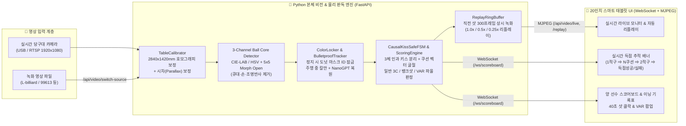

# 🎱 CUE24 (Q24) — AI 비전 기반 대대 3쿠션 무인 관제 및 실시간 자동 판독 SaaS 시스템

> **실시간 카메라 & 녹화 영상 통합 3구(흰공·노란공·빨간공) 추적 · 3체 인과 키스 분리 엔진(`CausalKissSafeFSM`) · 20인치 스마트 태블릿 디지털 점수판**

[](https://cue24.vercel.app)
[](https://www.python.org/)
[](https://fastapi.tiangolo.com/)
[](https://opencv.org/)
[](https://pytorch.org/)

---

## 📌 1. 프로젝트 개요 (Overview)

**CUE24(Q24)**는 당구장 천장 카메라(또는 테스트용 녹화 영상) 하나로 국제식 대대($2840\text{mm} \times 1420\text{mm}$) 위에서 움직이는 **3개의 당구공(흰공·노란공·빨간공)**을 실시간 추적하고, 3쿠션 경기 규칙에 따른 **일반 득점(1점) · 뱅크샷(PBA 모드 2점) · 키스(Kiss) · 더블터치 파울 · 공타(Miss)**를 사람의 개입 없이 자동으로 판별하여 **20인치 태블릿 스코어보드**에 즉시 반영하는 차세대 당구장 무인 관제 & 스마트 판독 SaaS 웹 애플리케이션입니다.

### ✨ 왜 CUE24인가? (핵심 차별점)
1. **단일 파이썬 본체 엔진 직결 구조**: 실시간 카메라 스트림뿐만 아니라 `[📁 영상 업로드]`로 선택한 어떤 녹화 영상이라도 브라우저 간이 루프로 빠지지 않고 **파이썬 OpenCV + 물리 추적 본체 엔진(`LiveStreamReader` + `CausalKissSafeFSM`)**으로 직결되어 100% 동일한 정확도로 판독합니다.
2. **조명 불변 3구 색상 분리 (CIE-L\*a\*b\* + HSV 환형 도넛 마스크)**: 차가운 주광색 LED 조명부터 따뜻한 전구색 조명 아래의 아라미스 아이보리 백구(`B < 164`)와 황구(`B >= 164`)까지 조명 환경이 바뀌어도 흔들림 없이 3구의 고유 색상을 분리합니다.
3. **수구-1적구 충돌 시 ID 스왑(1적구를 수구로 오인) 원천 차단**: 공-공 충돌 순간 직진 관성 예측점이 1적구 위로 포개져 ID가 뒤바뀌는 현상을 근접 충돌 게이트(`near_other_ball`)와 유색구 우선 확정(`RED -> YELLOW -> WHITE`)으로 원천 방어합니다.
4. **제2적구 충돌 즉시 실시간 득점 반영 & 7초 자동 리셋**: 공이 완전히 멈출 때까지 기다리지 않고, 3쿠션 이상 조건 충족 후 제2적구에 맞는 순간 **즉시 `+1점(뱅크샷 +2점)`**을 스코어보드에 반영하며, 판정 완료 7초 후 다음 이닝 대기 상태로 깔끔하게 자동 리셋됩니다.

---

## 🏗️ 2. 시스템 아키텍처 (System Architecture)



---

## 🔬 3. 핵심 알고리즘 및 기술 상세 (Core Technology)

### ① 당구대 평면 호모그래피 & 카메라 시차(Parallax) 보정 (`cue24/core/table_calibrator.py`)
- 기울어진 천장 카메라의 $1920 \times 1080$ 원본 프레임을 국제식 대대 내경 규격인 **$2840\text{mm} \times 1420\text{mm}$ ($2:1$ 물리 좌표계, $1\text{px} = 1\text{mm}$)** 평면으로 투시 변환(Perspective Warp)합니다.
- $0.25\times$ 초고속 캐싱 행렬(`_cached_quarter_H`, $710 \times 355$)을 사전 계산하여 프레임당 **약 $2.4\text{ms}$** 만에 전체 테이블 스캔을 완료합니다.
- 당구공의 높이(반지름 $30.75\text{mm}$)로 인해 카메라 각도에 따라 공의 겉보기 중심이 밀리는 현상을 `camera_tilt_ratio`로 보정하여 실제 바닥 접지점을 추출합니다.

### ② 조명 불변 3구 색상 잠금 & 큐대/손 절단 필터 (`cue24/core/color_locker.py`, `cue24/api/server.py`)
- **도넛(환형) 마스크**: 공 크롭 이미지의 상단 중심 $35\%$ (천장 LED 하이라이트 반사광)와 외곽 테두리 $15\%$ (파란색/초록색 라사지 그림자 번짐)를 도려낸 순수 중간 링 영역만 분석합니다.
- **3채널 독립 코어 추출 (`_extract_3_channel_ball_cores`)**:
  - **적구 (`RED`)**: $a^* \ge 144$, $b^* \ge 118$, $S \ge 55$, $V \ge 52$
  - **황구 (`YELLOW`)**: $b^* \ge 164$, $a^* < 146$, $L^* \ge 118$, $S \ge 100$
  - **백구 (`WHITE` / 아라미스 아이보리 포함)**: $L^* \ge 170$, $S \le 108$, $108 \le b^* < 164$, $a^* < 142$ 조건에 **$5 \times 5$ 타원형 모폴로지 열림(`MORPH_OPEN`)** 연산을 적용하여 수구에 맞닿은 가느다란 하얀색 큐대(샤프트)와 장갑을 100% 절단하고 둥근 공 코어만 남깁니다.

### ③ 5단계 철통 물리 추적기 & BilliardNanoGPT 가림 복원 (`cue24/core/physics_tracker.py`, `three_cushion_vision/billiard_nanogpt.py`)
- **1단계 (정지 시 색상 잠금)**: 샷 출발 전 정지 상태에서 3개 공의 ID(`1: WHITE`, `2: YELLOW`, `3: RED`)를 확정하고 기준점(`_rest_positions`)을 잠급니다.
- **2단계 (주행 중 색상 감지기 OFF)**: 수구가 출발(`SHOT_IN_PROGRESS`)하면 고속 모션블러에 의한 색상 오판을 막기 위해 색상 재분류를 잠그고 물리 궤적 추적으로 전환합니다.
- **3단계 (수구-1적구 충돌 시 ID 스왑 방어)**: 두 공이 $135\text{mm}$ 이내로 근접 충돌하는 순간(`near_other_ball = True`), 직진 관성 예측점(`pred_p`) 대신 직전 위치(`prev_p`) 기준으로 매칭하여 수구가 1적구로 갈아타는 ID 스왑을 원천 차단합니다.
- **4단계 (BilliardNanoGPT 비선형 반사 복원)**: 선수의 몸이나 큐대에 공이 가려졌을 때(Occlusion), 직선 칼만 필터의 한계를 넘어 쿠션 반사각까지 학습한 경량 트랜스포머 모델(`BilliardNanoGPT`)이 가려진 공의 비선형 궤적을 복원합니다.

### ④ 3체 인과 키스 분리 엔진 (`three_cushion_vision/causal_kiss_fsm.py`, `cue24/core/scoring_engine.py`)
- **실시간 득점 추적 배너 연동**:
  - **일반 샷 경로**: `[🎯 1적구] ⇒ [🔥 N쿠션] ⇒ [🎯 2적구] ⇒ [🏆 득점성공 / ❌ 득점실패]`
  - **뱅크샷 경로 (선행 쿠션 접촉)**: `[🔥 선행 N쿠션] ⇒ [🎯 1적구] ⇒ [추가 쿠션(있을 시)] ⇒ [🎯 2적구] ⇒ [🏆 득점성공(+2점/PBA)]`
- **선행 쿠션 오탐 방어**: 수구가 1적구를 먼저 쳤음에도 쿠션 근처에 있던 1적구 때문에 뱅크샷으로 오인하는 현상을 방지하기 위해, 수구-1적구 실제 거리($\le 72\text{mm}$)와 속도 벡터 굴절을 교차 검증합니다.
- **Micro-Hawk VAR 현미경 판독 (`cue24/core/var_referee.py`)**: 초근접 스침(Micro-Contact, $0.5\text{mm}$ 이내 굴절) 및 쿠션/수구 더블터치(Double-Touch, 극솟점 2회 발생) 파울을 밀리초($\text{ms}$) 단위로 정밀 감식합니다.

---

## 📂 4. 디렉토리 구조 (Project Structure)

```text
Q24/
├── cue24/                              # 메인 백엔드 서버 및 코어 패키지
│   ├── main.py                         # FastAPI 서버 단독 실행 엔트리포인트
│   ├── requirements.txt                # Python 의존성 패키지 목록
│   ├── config/
│   │   └── settings.py                 # 국제식 대대 물리 규격(2840x1420mm) 및 LAB 색상 임계값 설정
│   ├── api/
│   │   └── server.py                   # LiveStreamReader, FastAPI REST 엔드포인트, WebSocket & MJPEG 스트리머
│   ├── core/
│   │   ├── table_calibrator.py         # 당구대 4모서리 자동 검출, 호모그래피 변환 및 시차(Parallax) 보정
│   │   ├── color_locker.py             # 환형(도넛) 마스크 기반 조명/그림자 제거 및 3구 색상 확정
│   │   ├── physics_tracker.py          # 칼만 필터 + 헝가리안 매칭 + 스핀 에너지 정지 감지기
│   │   ├── scoring_engine.py           # 3쿠션 벡터 굴절/반사 기반 일반득점·뱅크샷·키스 판정 엔진
│   │   ├── var_referee.py              # Micro-Hawk VAR 미세 접촉 및 더블터치 파울 감식기
│   │   └── replay_buffer.py            # 300프레임 순환 링버퍼 및 멀티배속(1.0x/0.5x/0.25x) 리플레이 생성기
│   ├── services/
│   │   └── match_manager.py            # 경기 상태 머신(FSM), 선수/이닝/하이런/에버리지/40초 샷클락 관리
│   ├── mcp/
│   │   └── billiard_physics_mcp.py     # 로컬 3쿠션 물리/AI 판독 검증용 MCP(Model Context Protocol) 서버
│   ├── static/
│   │   └── index.html                  # 20인치 태블릿 전용 스마트 스코어보드 통합 프론트엔드 UI
│   └── tests/                          # 단계별(Step 2 ~ Step 10) 단위 및 통합 검증 테스트 스위트
├── three_cushion_vision/               # 고급 3체 인과 물리 & 딥러닝 궤적 복원 패키지
│   ├── causal_kiss_fsm.py              # 3체 인과 키스 분리 및 유효 3쿠션 판별 유한상태기계(FSM)
│   ├── kinematics_detector.py          # 프레임 간 속도 벡터 급변(Jerk/Deflection) 기반 충돌 감지기
│   ├── billiard_nanogpt.py             # 가림(Occlusion) 구간 비선형 쿠션 반사 궤적 복원 NanoGPT 모델
│   ├── scoreboard_bridge.py            # 비전 판독 결과 <-> 스코어보드 실시간 브릿지
│   └── tests/                          # 키스/파울/득점 시나리오 정밀 테스트
├── public/
│   └── index.html                      # Vercel 정적 배포용 빌드 산출물
├── index.html                          # 루트 정적 엔트리 파일
├── package.json                        # 프론트엔드 빌드 스크립트 (npm run build)
└── vercel.json                         # Vercel 프로덕션 배포 라우팅 설정
```

---

## 🚀 5. 설치 및 실행 방법 (Getting Started)

### 1) 사전 요구사항 (Prerequisites)
- **Python**: `3.11` 이상
- **Node.js**: `18.x` 이상 (프론트엔드 정적 빌드 및 배포용)

### 2) 패키지 설치 (Installation)
```bash
# 1. 저장소 클론
git clone https://github.com/ic4u2u/Q24.git
cd Q24

# 2. Python 필수 패키지 설치
pip install -r cue24/requirements.txt
```

### 3) 로컬 본체 판독 서버 실행 (Run Local Server)
```bash
# FastAPI + Uvicorn 실시간 비전 판독 서버 구동 (포트 8000)
python -m uvicorn cue24.api.server:app --host 0.0.0.0 --port 8000
```
- 서버 구동 후 브라우저에서 **`http://localhost:8000`** 에 접속합니다.
- 상단 **`[📁 영상 업로드]`** 버튼을 클릭하거나 당구 영상 파일(`.mp4`)을 모니터 영역에 **드래그 앤 드롭(Drag & Drop)**하면, 파이썬 본체 엔진이 즉시 해당 영상을 마운트하여 실시간 카메라 스트림과 동일하게 자동 채점을 수행합니다.

### 4) 프론트엔드 빌드 및 Vercel 배포 (Build & Deploy)
```bash
# cue24/static/index.html 수정 사항을 index.html 및 public/index.html로 동기화
npm run build

# Vercel 프로덕션 배포
npx vercel --prod
```

---

## 🔌 6. 주요 API 및 WebSocket 명세 (API Reference)

### REST API 엔드포인트
| 메서드 | 경로 | 설명 |
| :--- | :--- | :--- |
| `GET` | `/` | 20인치 스마트 태블릿 디지털 스코어보드 메인 화면 반환 |
| `GET` | `/api/video/live` | 실시간 $1.0\times$ 정배속 카메라/녹화영상 MJPEG 스트림 송출 및 실시간 비전 판독 |
| `GET` | `/api/video/replay?speed=1.0` | 직전 샷 클립 1회 자동 리플레이 송출 (`1.0`, `0.5`, `0.25` 배속 지원) |
| `POST` | `/api/video/switch-source` | 브라우저에서 선택한 영상(`{"filename": "..."}`)을 파이썬 본체 엔진으로 무복사 즉시 직결 |
| `GET` | `/api/match/state` | 현재 경기 전체 상태(양 선수 점수, 이닝, 하이런, 에버리지, 타이머, 판독 진단값) 조회 |
| `POST` | `/api/match/reset` | 경기 초기화, 0프레임 되감기 및 3구 색상 즉시 재잠금 |
| `POST` | `/api/match/rule-mode` | 경기 룰 모드 전환 (`STANDARD`: 일반 1점 / `PBA`: 뱅크샷 2점) |
| `POST` | `/api/match/swap-player-names` | **[선수변경]** 공 색깔 진영은 유지하고 좌우 선수 이름·핸디만 맞바꿈 |
| `POST` | `/api/match/swap-seats-full` | **[자리바꿈]** 좌우 선수 이름·점수·수구 색상(흰공/노란공) 진영 전체 스왑 |

### WebSocket 실시간 이벤트 (`/ws/scoreboard`)
- **서버 ➔ 클라이언트 브로드캐스트**:
  - `SCORE_UPDATED`: 실시간 쿠션 카운트, 제1·2적구 접촉 상태, 득점 가산, 40초 샷 클락 동기화
  - `TURN_CHANGED`: 공타(Miss) 또는 시간 초과(Time-out)로 인한 공격권 교대 및 이닝 증가
  - `AUTO_REPLAY_READY`: 3공 완전 정지 시 직전 샷 리플레이 클립 준비 완료 알림
  - `VAR_ALERT`: Micro-Hawk VAR 미세 접촉 또는 더블터치 파울 감식 결과 알림
- **클라이언트 ➔ 서버 액션 (`action`)**:
  - `START_MATCH`, `RESET_MATCH`, `END_MATCH`, `TOGGLE_PAUSE`, `USE_TIMEOUT`, `ADJUST_SCORE`, `SET_RULE_MODE`, `SWITCH_TURN`, `SWAP_PLAYER_NAMES`, `SWAP_SEATS_FULL`

---

## 🧪 7. 테스트 실행 (Running Tests)

단계별 비전·물리·채점 엔진 단위 테스트 및 키스/파울 시나리오 검증을 아래 명령어로 실행할 수 있습니다.

```bash
# CUE24 코어 엔진 단계별(Step 2 ~ Step 10) 통합 테스트
pytest cue24/tests/

# 3체 인과 키스 분리(CausalKissSafeFSM) 및 파울 시나리오 테스트
pytest three_cushion_vision/tests/
```

---

## 📄 라이선스 (License)

Copyright © 2026 **CUE24 (Q24)**. All rights reserved.
